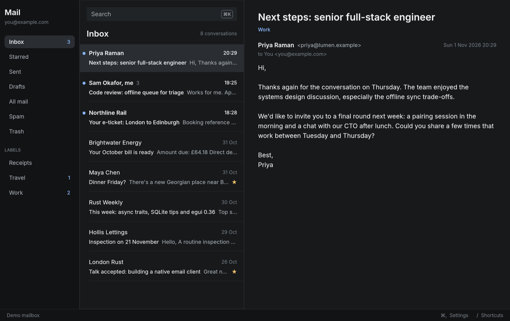

# Mail

A fast native Gmail client for Apple Silicon Macs, built in public.

Mail keeps a local copy of your recent Gmail in SQLite. Reading and searching
work offline and take milliseconds; the network is only used to sync. The same
binary has a command line and a one-shot JSON CLI that coding agents such as
Claude Code and Codex can use to search your mail and write drafts. Only you
send, from the window, after a confirmation.



> **Status: milestone 3.** Sync, offline search, the keyboard-driven window
> and replies and new messages, saved as drafts or sent after you confirm,
> work. See the [milestones](docs/design.md#milestones).

## Why

Email is the one app I use all day that I haven't replaced with something
faster. I want Gmail's data with a native app's speed: instant search,
triage from the keyboard, and no browser tab.

## Quick start

You need a Mac with Apple Silicon and Rust (`rustup` picks the pinned
toolchain automatically).

```bash
git clone https://github.com/fightingentropy/mail && cd mail
cargo install --locked --path crates/mail
```

`~/.cargo/bin/mail` takes the place of macOS's old `/usr/bin/mail` when
`~/.cargo/bin` comes first in your `PATH`, which is rustup's default.

To get the window as an app in `/Applications`, with its own icon:

```bash
packaging/macos/build-app.sh --install --link-cli --open
```

The script signs with your Developer ID if you have one (hardened runtime,
secure timestamp), else ad hoc. A stable signature means macOS remembers
"Always Allow" for Mail's Keychain item across rebuilds. `--link-cli` makes
the terminal `mail` the app's own binary, so both share that one approval.
`--notarize <profile>` notarizes and staples the app with a
`xcrun notarytool store-credentials` profile. The app sits beside Apple's
Mail, which stays where it is in `/System/Applications`.

Then connect your Gmail. This uses your own Google Cloud OAuth client; the
[setup guide](docs/google-setup.md) takes about ten minutes.

```bash
mail auth --client ~/Downloads/client_secret_XXXX.json   # sign in in the browser
mail sync                                                 # first run: last 90 days
mail search invoice --label inbox --since 2026-10-01
mail thread 19a2b3c4d5e6f708
mail draft --reply 19a2b3c4d5e6f708 --body "Thanks, see you Friday."
mail status
```

Later runs of `mail sync` only fetch what changed.

## The window

Run `mail` with no command. Everything on screen comes from the local
database, so the window opens and responds instantly; it syncs in the
background while open (at launch, every two minutes, and right after you
triage) and nothing runs once you quit.

Gmail's letters and the usual macOS chords both work:

| Gmail | macOS | Does |
|---|---|---|
| `j` `k` | `↓` `↑` | Next and previous conversation |
| `e` | `⌃⌘A` | Archive |
| `#` | `⌘⌫`, Delete | Move to Trash |
| `u` | `⇧⌘U` | Mark read or unread |
| `s` | `⇧⌘L` | Star or unstar |
| `l` | | Add or remove a label |
| `z` | `⌘Z` | Undo |
| `r` / `a` / `c` | `⌘R` / `⇧⌘R` / `⌘N` | Reply, reply all, new message |
| | `⌘K` | Search, live as you type |
| Space | | Scroll the conversation |
| `h` | | Open the message's HTML version in your browser |
| `g` then `i` `s` `t` `d` `a` | | Inbox, Starred, Sent, Drafts, All mail |
| | `⌘↩` | Send, after a confirmation showing who it goes to |
| | `⌘S` / `⇧⌘D` | Save the draft to Gmail's Drafts / discard it |
| | `⇧⌘N` | Sync now |
| `/` or `?` | | All shortcuts |
| | `⌘,` | Settings |

Every shortcut can be changed in Settings: click + next to an action and
press the keys you want (a plain letter followed by another within a second
makes a sequence like `g i`). A shortcut already in use moves to the new
action, and Reset puts the defaults back. Changes are saved to
`shortcuts.json` in Mail's data folder, as the difference from the defaults.

Right-click a conversation for the same actions, with their shortcuts.

Triage applies locally at once and waits in a queue until the next sync sends
it to Gmail, so it works offline too.

The reader shows mail as plain text. Web and email links are in blue: hover
one to see its full address, click to open it. Click an attachment to save
it to Downloads and open it; anything that could run code (apps, scripts,
installers, archives) is shown in Finder instead of opened. For mail that
needs its layout, `h` opens the original HTML in your browser. Scripts are
blocked there, but remote images load, which tells the sender you opened
the message. The window follows macOS's light or dark appearance.

Try it without a Google account:

```bash
mail --demo
```

## For agents

```bash
mail agent tools
mail agent call search '{"query": "flight lisbon", "since": "2026-09-01"}'
mail agent call read_thread '{"thread_id": "19a2b3c4d5e6f708"}'
mail agent call create_draft '{"reply_to": "19a2b3c4d5e6f708", "body": "Booked, thanks."}'
```

Every call opens the database read-only, prints one JSON object and exits.
There is no MCP server, daemon or open port. The reading tools work offline;
`create_draft` is the only tool that writes, and it writes only to your Gmail
Drafts for you to review. No tool can send, delete or relabel mail. The tool
descriptions tell agents that email content is untrusted input, never
instructions, and never a reason to draft something.

## How it works

```
mail (CLI, agent CLI, window)  →  mail-core: auth · gmail · sync · store
                                               │        │       │
                                    OAuth + PKCE    Gmail API    SQLite + FTS5
```

- **Gmail API with OAuth.** PKCE and a loopback redirect, with the refresh
  token in the macOS Keychain. Mail never sees your password.
- **Sync.** The first run downloads the last 90 days, paced to Gmail's quota
  (about 100 full messages a minute). Past 300 messages it stores headers
  first, three times faster, so the mailbox is usable sooner, then fills in
  bodies newest first. After that, Gmail's History API supplies exact
  changes in a fraction of a second.
- **Store.** One SQLite file in WAL mode. Messages, labels and attachment
  metadata are stored; HTML is kept compressed in its own table and
  attachments download only when opened.
- **Search.** An FTS5 index over subject, sender, recipients and body,
  ranked with bm25. Words match as you type, from the second letter, in a
  millisecond or two ([numbers](docs/design.md#performance)).
- **Writing.** Replies are built locally as RFC 5322 messages, threaded with
  `In-Reply-To` and `References`, and saved through Gmail's drafts API. The
  window sends a saved draft (`drafts.send`) only after you confirm; the
  agent CLI and `mail draft` can't send.
- **Window.** egui/eframe with an embedded Inter font. The drawing code reads
  a model that has no egui in it, so tests drive the window like a person at
  the keyboard.

The [design doc](docs/design.md) explains the decisions, including why
OAuth beats an IMAP app password here.

## Development

```bash
cargo test --workspace
cargo clippy --workspace --all-targets -- -D warnings
cargo fmt --all
```

`mail-core` holds the engine and has no UI code. Its sync logic is tested
against an in-memory fake of the Gmail API, so tests never touch a real
mailbox. Test data and the demo mailbox are made up.

`mail --demo --screenshot out.png` renders the window to a PNG and quits;
add `--demo-keys "j e cmd+k text:seat"` to press keys first (`click:x,y`,
`rightclick:x,y` and `hover:x,y` work too, in points), and `--appearance
light` or `dark` to pick the palette. That is how the screenshot above is made and how the window's
keyboard handling gets checked without a person at the keyboard.

## Privacy

Your mail stays on your Mac and with Google. Mail has no server, no
analytics and no telemetry. The database lives in
`~/Library/Application Support/org.erlin.mail/`; delete that folder and the
Keychain item (`security delete-generic-password -s org.erlin.mail`) to
remove everything.

## Credits

Mail's shape (a Rust engine with SQLite FTS5 search and a read-only agent
CLI) follows my [Whatsapp](https://github.com/fightingentropy/Whatsapp)
client, which extends Carmine Paolino's MIT-licensed
[ZapFast](https://github.com/crmne/zapfast). Mail reuses patterns, not code.

Built on [SQLite](https://sqlite.org) via
[rusqlite](https://github.com/rusqlite/rusqlite),
[egui and eframe](https://github.com/emilk/egui),
[ureq](https://github.com/algesten/ureq),
[serde](https://serde.rs), [clap](https://github.com/clap-rs/clap),
[jiff](https://github.com/BurntSushi/jiff),
[encoding_rs](https://github.com/hsivonen/encoding_rs) and
[security-framework](https://github.com/kornelski/rust-security-framework).
The window uses the [Inter](https://rsms.me/inter/) typeface under the SIL
Open Font License ([license](crates/mail/assets/fonts/Inter-LICENSE.txt)).

Mail is not affiliated with Google. Gmail is a trademark of Google LLC.

## License

[MIT](LICENSE)
